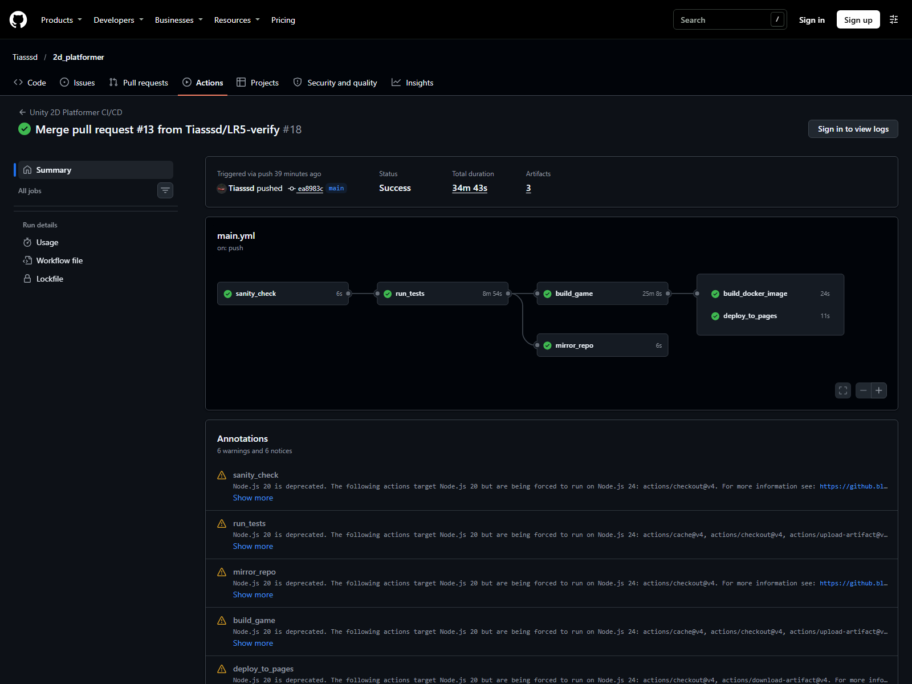
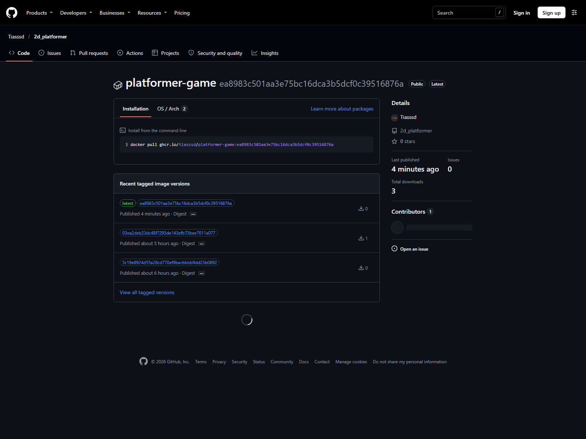
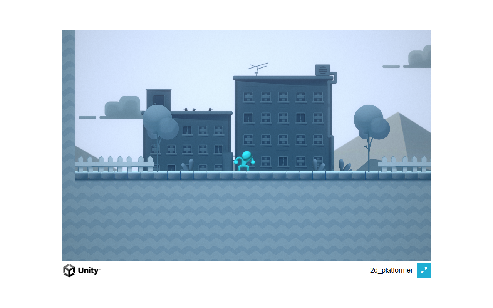

# АРПО. Лабораторная работа №5 — Автоматическая компиляция WebGL-игры в облаке и деплой на GitHub Pages

**Студент:** Шех М.И., группа 23-СТ
**Дисциплина:** Автоматизация разработки программного обеспечения
**Преподаватель:** Бровко Н.В.
**Репозиторий:** https://github.com/Tiasssd/2d_platformer (рабочая ветка `LR5`)
**Игра на GitHub Pages:** https://tiasssd.github.io/2d_platformer/
**Docker-образ:** `ghcr.io/tiasssd/platformer-game:latest`

## Цель работы

Настроить сквозной пайплайн, который после успешных тестов компилирует реальный WebGL-билд игры в облаке, публикует его на GitHub Pages и собирает Docker-образ с живой игрой вместо файлов-заглушек.

## Задание

1. Включить в Unity 6 сжатие Gzip и галочку Decompression Fallback для работы на статическом хостинге.
2. Добавить в пайплайн задачу `build_game`, которая запускает `BuildManager.BuildWebGL` в контейнере Unity.
3. Передавать скомпилированные файлы между задачами через артефакт `WebGL-Build`.
4. Собирать Docker-образ с настоящей игрой вместо заглушек.
5. Публиковать игру в ветку `gh-pages` и включить GitHub Pages.
6. Создать файл `LR5.md`, обновить `README.md` и таблицу лабораторных работ.

## Решение

### Подготовка Unity к GitHub Pages

В `ProjectSettings/ProjectSettings.asset` установлены значения `webGLCompressionFormat: 1` (Gzip) и `webGLDecompressionFallback: 1`. Флаг резервной декомпрессии обязателен: GitHub Pages не отправляет заголовок `Content-Encoding` для предсжатых файлов, поэтому распаковку `.gz` выполняет JavaScript-распаковщик, внедрённый Unity. Без него игра зависает на полосе загрузки с ошибкой распаковки. Проверка настроек выполнена командой:

```
grep -n "webGLCompressionFormat\|webGLDecompressionFallback" ProjectSettings/ProjectSettings.asset
```

### Облачная сборка

Задача `build_game` запускается после `run_tests` и использует официальный CLI GameCI. В методичке приведён экшен `game-ci/unity-builder@v4`, но он требует файл `.ulf` или серийный номер `UNITY_SERIAL`; для бесплатной Unity Personal офлайн-активация больше не выдаётся. CLI `game-ci build` использует тот же механизм персональной активации по `UNITY_EMAIL` и `UNITY_PASSWORD`, который успешно работает в задаче `run_tests`, поэтому в пайплайне применён он. Команда сборки вызывает метод `BuildManager.BuildWebGL` из ЛР №1. Фрагмент пайплайна приведён в листинге 1.

Листинг 1 — Задача `build_game`

```yaml
  build_game:
    needs: run_tests
    runs-on: ubuntu-latest
    steps:
      - name: Checkout code
        uses: actions/checkout@v4
        with:
          lfs: true
      - name: Cache Library
        uses: actions/cache@v4
        with:
          path: Library
          key: Library-Build-${{ hashFiles('Packages/packages-lock.json', 'Assets/**/*.asmdef') }}
      - name: Install GameCI CLI
        run: |
          curl -sL -o game-ci.tar.gz https://github.com/game-ci/cli/releases/download/v0.1.72/game-ci-linux-x64.tar.gz
          tar xzf game-ci.tar.gz ./game-ci
          echo "$PWD" >> $GITHUB_PATH
      - name: Build WebGL Player
        run: |
          game-ci build --engine=unity --targetPlatform=WebGL \
            --buildMethod=BuildManager.BuildWebGL \
            --engineVersion=6000.3.10f1 \
            --dockerIsolationMode=default \
            --containerRegistryRepository=unityci/editor \
            --containerRegistryImageVersion=3
        env:
          UNITY_EMAIL: ${{ secrets.UNITY_EMAIL }}
          UNITY_PASSWORD: ${{ secrets.UNITY_PASSWORD }}
      - name: Upload WebGL Artifact
        uses: actions/upload-artifact@v4
        with:
          name: WebGL-Build
          path: Builds/WebGL
```

### Передача файлов через артефакты

Папка `Builds/WebGL` исключена из Git через `.gitignore`, поэтому между задачами файлы передаются через артефакт `WebGL-Build`. Задача `build_game` загружает его, а задачи `build_docker_image` и `deploy_to_pages` скачивают в ту же папку. Это заменяет заглушки `touch` из ЛР №3: в Docker-образ и на GitHub Pages попадают настоящие файлы сборки.

При включённом Decompression Fallback Unity 6 выдаёт сжатые файлы с расширением `.unityweb`: `WebGL.data.unityweb`, `WebGL.framework.js.unityweb`, `WebGL.wasm.unityweb`. Внутри это тот же gzip (первые байты `1F 8B`), но расширение изменено намеренно: сервер отдаёт файл без заголовка `Content-Encoding`, а встроенный JS-загрузчик распаковывает его сам. Поэтому в CI проверяется наличие `index.html`, `Build/WebGL.loader.js` и `Build/*.unityweb`, а не `.gz`. Режимы «`.gz` + заголовок сервера» и «`.unityweb` + JS-распаковка» взаимоисключающие: для GitHub Pages нужен второй.

### Docker-образ и GitHub Pages

Задача `build_docker_image` ожидает `build_game`, скачивает артефакт и собирает образ `ghcr.io/tiasssd/platformer-game` под тегами `latest` и `${{ github.sha }}`. Задача `deploy_to_pages` скачивает тот же артефакт и публикует папку `Builds/WebGL` в ветку `gh-pages` действием `JamesIves/github-pages-deploy-action@v4`.

Сам хостинг GitHub Pages включается один раз в настройках репозитория: `Settings → Pages → Deploy from a branch → Branch: gh-pages, Folder: / (root)`. После включения каждый новый успешный билд обновляет страницу автоматически.

### Результаты

После объединения pull request с `main` пайплайн выполнил все задачи. В журнале `build_game` появилась строка `[CI/CD] УСПЕХ! WebGL билд успешно создан.` с временем и размером сборки — значит, компиляция выполнена именно методом `BuildManager.BuildWebGL`, а не стандартной сборкой Unity. Успешный прогон показан на рисунке 1.



Артефакт `WebGL-Build` содержит настоящие файлы сборки: `index.html`, `Build/WebGL.loader.js`, `WebGL.data.unityweb`, `WebGL.framework.js.unityweb` и `WebGL.wasm.unityweb`. Файлы `.unityweb` — это gzip внутри (первые байты `1F 8B`); так Unity 6 поступает при включённом Decompression Fallback. В ветке `gh-pages` лежат `index.html`, `Build`, `StreamingAssets` и `TemplateData`. Образ `platformer-game` опубликован в GHCR с тегами `latest` и SHA коммита, что показано на рисунке 2.



Игра открывается по адресу https://tiasssd.github.io/2d_platformer/ и работает в браузере, что показано на рисунке 3.



Параметры облачной сборки приведены в таблице 1.

Таблица 1 — Параметры облачной сборки WebGL

| Параметр | Значение |
|---|---|
| Версия Unity | 6000.3.10f1 |
| Режим сжатия | Gzip + Decompression Fallback |
| Время сборки | 770,73 с |
| Размер сборки | 21 476 940 байт |
| Артефакт | `WebGL-Build` |
| Файлы | `index.html`, `Build/*.unityweb`, `Build/WebGL.loader.js` |

## Вывод

Настроен сквозной пайплайн: после успешных тестов Unity облачный сервер компилирует WebGL-сборку методом `BuildManager.BuildWebGL`, передаёт её через артефакт в задачи сборки Docker-образа и публикации на GitHub Pages. Docker-образ содержит настоящую игру, а не заглушки; игра доступна по постоянной ссылке GitHub Pages. Версия Unity фиксируется явно, лицензия Personal активируется по секретам `UNITY_EMAIL` и `UNITY_PASSWORD`. Кэш папки `Library` сокращает повторные сборки.

## Контрольные вопросы

**Вопрос 1. Почему папка `Builds/WebGL` закрыта правилом `.gitignore` и каким образом скомпилированные файлы попадают в задачи `build_docker_image` и `deploy_to_pages`?**

`Builds/WebGL` — результат сборки, а не исходный код. Она содержит большие бинарные файлы, которые меняются при каждой компиляции; хранить их в Git бессмысленно и вредно: репозиторий разрастается, а история засоряется. Поэтому папка исключена через `.gitignore`. В CI задача `build_game` компилирует игру и загружает папку в артефакт `WebGL-Build` действием `upload-artifact`. Задачи `build_docker_image` и `deploy_to_pages` скачивают этот артефакт действием `download-artifact` в `Builds/WebGL` и уже оттуда берут файлы для Docker и ветки `gh-pages`.

**Вопрос 2. Зачем задаче `build_game` указывать `needs: run_tests` и что произойдёт с остальными задачами, если тесты упадут?**

`needs: run_tests` делает тесты гейтом качества: сборка начинается только после успешного прохождения EditMode и PlayMode. Если тесты падают, GitHub Actions не запускает `build_game`, а вместе с ней не запускаются `build_docker_image` и `deploy_to_pages` — они остаются в состоянии `Skipped`. В GHCR не попадает образ со сломанной игрой, а на GitHub Pages не публикуется сломанная версия.

**Вопрос 3. Какую роль в облачной сборке выполняет метод `BuildManager.BuildWebGL` и почему результат его работы виден пайплайну?**

Этот метод из ЛР №1 получает список активных сцен из `EditorBuildSettings`, настраивает `BuildPlayerOptions` под WebGL и вызывает `BuildPipeline.BuildPlayer`. В конце он анализирует `BuildSummary`: при успехе пишет `[CI/CD] УСПЕХ!`, при ошибке — сообщение об ошибке, и в batchmode завершает Unity через `EditorApplication.Exit(code)`. Ненулевой код возврата виден шагу пайплайна, поэтому облачная сборка считается упавшей, если компиляция не удалась.

**Вопрос 4. Почему GitHub Pages требует галочки Decompression Fallback, а Docker-образ с Nginx обходится без неё?**

GitHub Pages — статический хостинг: он отдаёт файлы как есть и не умеет добавлять заголовок `Content-Encoding: gzip` для предсжатых `.gz`. Браузер не понимает, что внутри gzip-поток, и игра не запускается. Флаг Decompression Fallback заставляет Unity внедрить в сборку JavaScript-распаковщик, который распаковывает файлы на стороне клиента. В Docker-образе стоит Nginx с кастомным `nginx.conf`, который сам добавляет `Content-Encoding: gzip` и правильный MIME-тип, поэтому клиентская распаковка не нужна.

**Вопрос 5. Чем отличается доставка игры через GitHub Pages и через Docker-образ в GHCR, и зачем нужны теги `latest` и `github.sha`?**

GitHub Pages — бесплатный статический хостинг для быстрой проверки и демонстрации: ссылка открывается в браузере, но требуется включённый Pages и нет управления сервером. Docker-образ в GHCR — переносимый артефакт: его можно запустить на любом сервере с Docker командой `docker run -p 8080:80 ghcr.io/tiasssd/platformer-game:latest`, он содержит Nginx и игру внутри. Тег `latest` указывает на последнюю версию для быстрого запуска, а тег `github.sha` привязывает образ к конкретному коммиту, позволяя откатиться на любую предыдущую сборку.

**Вопрос 6. Почему при успешном выполнении задачи `deploy_to_pages` сайт может отдавать 404 и как это исправить?**

Задача `deploy_to_pages` только публикует файлы в ветку `gh-pages`; сам хостинг GitHub Pages нужно один раз включить в настройках репозитория. Пока Pages не включён, ссылка `https://tiasssd.github.io/2d_platformer/` возвращает 404, даже если пайплайн зелёный. Исправление: `Settings → Pages → Build and deployment → Source: Deploy from a branch → Branch: gh-pages, Folder: / (root) → Save`. После включения все последующие успешные сборки обновляют страницу автоматически.
