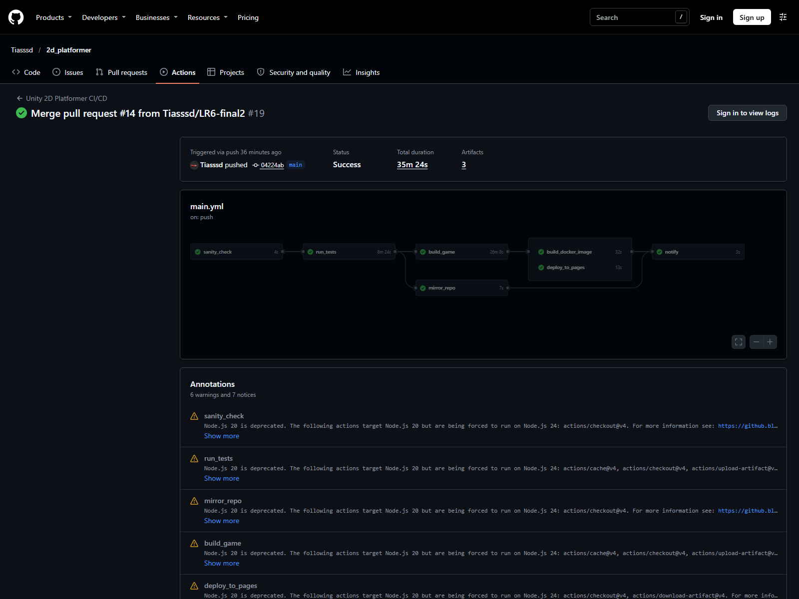
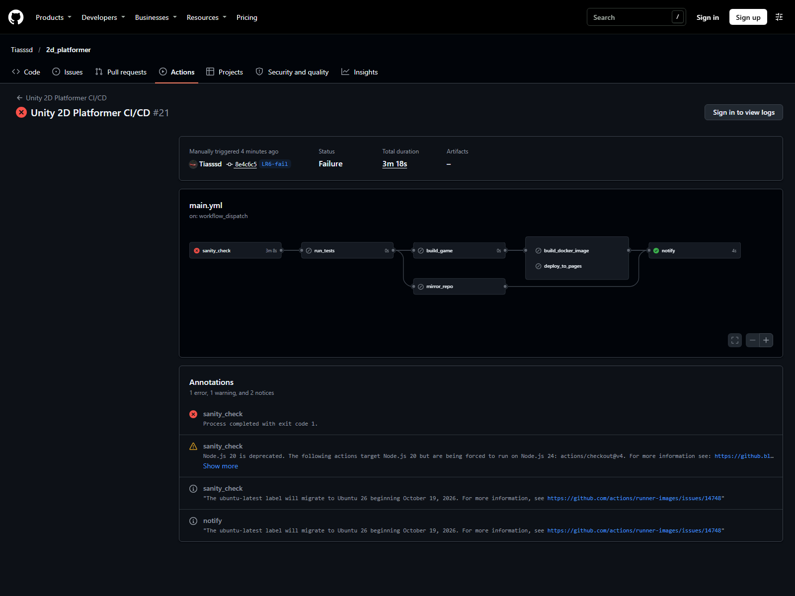

# АРПО. Лабораторная работа №6 — Мониторинг пайплайна, Webhooks и Telegram-оповещения

**Студент:** Шех М.И., группа 23-СТ
**Дисциплина:** Автоматизация разработки программного обеспечения
**Преподаватель:** Бровко Н.В.
**Репозиторий:** https://github.com/Tiasssd/2d_platformer (рабочая ветка `LR6`)
**Telegram-бот:** `@arpo_lab6_shekh_bot`

## Цель работы

Настроить обратную связь от облачного сервера к команде разработки: после каждого прогона пайплайна Telegram-бот должен отправлять сообщение с результатом — успешным или с указанием упавшей задачи.

## Задание

1. Создать Telegram-бота через `@BotFather`, получить токен и идентификатор чата.
2. Сохранить токен и `chat_id` в секретах репозитория `TELEGRAM_BOT_TOKEN` и `TELEGRAM_CHAT_ID`.
3. Добавить в `.github/workflows/main.yml` задачу `notify`, которая зависит от всех остальных задач и выполняется при любом исходе через `if: always()`.
4. Реализовать два сценария уведомления: успешный прогон и падение одной из задач.
5. Проверить оба сценария и вернуть пайплайн в рабочее состояние.

## Решение

### Создание бота и секретов

В Telegram через официального бота `@BotFather` создан бот `ARPO Lab6 Bot` с username `@arpo_lab6_shekh_bot`. Команда `/newbot` выдала токен вида `123456789:AAH…`; токен и `chat_id` личного чата сохранены в секретах репозитория:

| Секрет | Назначение |
|---|---|
| `TELEGRAM_BOT_TOKEN` | токен бота из `@BotFather` |
| `TELEGRAM_CHAT_ID` | идентификатор личного чата получателя |

Значения секретов не попадают ни в `main.yml`, ни в другие файлы репозитория. В журналах GitHub Actions они маскируются звёздочками. При компрометации токен отзывается командой `/revoke` у `@BotFather`.

### Задача notify

Задача `notify` добавлена в конец пайплайна. В `needs` перечислены все остальные задачи: `sanity_check`, `run_tests`, `build_game`, `build_docker_image`, `deploy_to_pages`, `mirror_repo`. Условие `if: always()` запускает её даже тогда, когда зависимые задачи упали или были пропущены.

Первый шаг определяет первую упавшую задачу и записывает её имя в `steps.status.outputs.stage`. Второй шаг формирует текст сообщения и отправляет POST-запрос к Telegram Bot API методом `sendMessage`. При успешном прогоне сообщение содержит ссылку на игру, автора коммита и ссылку на прогон; при падении — имя упавшей задачи, автора и ссылку на лог. Фрагмент пайплайна приведён в листинге 1.

Листинг 1 — Задача `notify`

```yaml
  notify:
    needs: [ sanity_check, run_tests, build_game, build_docker_image, deploy_to_pages, mirror_repo ]
    if: always()
    runs-on: ubuntu-latest
    steps:
      - name: Determine pipeline status
        id: status
        run: |
          if [ "${{ needs.sanity_check.result }}" != "success" ]; then echo "stage=sanity_check" >> $GITHUB_OUTPUT
          elif [ "${{ needs.run_tests.result }}" != "success" ]; then echo "stage=run_tests" >> $GITHUB_OUTPUT
          elif [ "${{ needs.build_game.result }}" != "success" ]; then echo "stage=build_game" >> $GITHUB_OUTPUT
          elif [ "${{ needs.build_docker_image.result }}" != "success" ]; then echo "stage=build_docker_image" >> $GITHUB_OUTPUT
          elif [ "${{ needs.deploy_to_pages.result }}" != "success" ]; then echo "stage=deploy_to_pages" >> $GITHUB_OUTPUT
          elif [ "${{ needs.mirror_repo.result }}" != "success" ]; then echo "stage=mirror_repo" >> $GITHUB_OUTPUT
          else echo "stage=none" >> $GITHUB_OUTPUT
          fi
      - name: Send Telegram notification
        env:
          BOT_TOKEN: ${{ secrets.TELEGRAM_BOT_TOKEN }}
          CHAT_ID: ${{ secrets.TELEGRAM_CHAT_ID }}
          STAGE: ${{ steps.status.outputs.stage }}
          SITE_URL: "https://tiasssd.github.io/2d_platformer/"
          RUN_URL: "${{ github.server_url }}/${{ github.repository }}/actions/runs/${{ github.run_id }}"
          AUTHOR: ${{ github.event.head_commit.author.name || github.actor }}
        run: |
          if [ "$STAGE" = "none" ]; then
            TEXT="Сборка 2d_platformer завершена успешно.\nАвтор коммита: ${AUTHOR}\nИгра доступна: ${SITE_URL}\nПрогон: ${RUN_URL}"
          else
            TEXT="Сборка 2d_platformer упала на задаче ${STAGE}.\nАвтор коммита: ${AUTHOR}\nЛог прогона: ${RUN_URL}"
          fi
          curl -s -X POST "https://api.telegram.org/bot${BOT_TOKEN}/sendMessage" \
            -H "Content-Type: application/json" \
            -d "{\"chat_id\":\"${CHAT_ID}\",\"text\":\"${TEXT}\"}"
```

### Проверка успешного сценария

После объединения pull request с веткой `main` пайплайн полностью отработал (все задачи, включая `notify`, зелёные), и в Telegram пришло сообщение:

> Сборка 2d_platformer завершена успешно.
> Автор коммита: Tiasssd
> Игра доступна: https://tiasssd.github.io/2d_platformer/
> Прогон: https://github.com/Tiasssd/2d_platformer/actions/runs/43330118914

Успешный прогон показан на рисунке 1.



### Проверка аварийного сценария

Для демонстрации защиты в ветке `LR6-fail` временно изменена проверка структуры: `sanity_check` искал несуществующую папку `ProjectSettings_MISSING`. Пайплайн запущен вручную через `workflow_dispatch`. Задача `sanity_check` завершилась ошибкой, задачи `run_tests`, `build_game`, `build_docker_image`, `deploy_to_pages` и `mirror_repo` остались в состоянии `Skipped`, а `notify` выполнилась и осталась зелёной. В Telegram пришло сообщение:

> Сборка 2d_platformer упала на задаче sanity_check.
> Автор коммита: Tiasssd
> Лог прогона: https://github.com/Tiasssd/2d_platformer/actions/runs/43330483675

Аварийный прогон показан на рисунке 2.



После проверки ветка `LR6-fail` удалена, а следующий прогон в `main` снова стал зелёным.

## Вывод

В пайплайн добавлена задача `notify`, которая через Webhook отправляет POST-запрос в Telegram Bot API. Благодаря `needs` она знает результат каждой задачи, а благодаря `if: always()` выполняется даже при падении пайплайна. Токен бота и `chat_id` хранятся только в секретах GitHub и маскируются в журналах. Проверены оба сценария: успешная сборка присылает ссылку на игру и прогон, аварийная — имя упавшей задачи и ссылку на лог. Задача `notify` при этом остаётся зелёной, потому что сам факт отправки сообщения выполнен.

## Контрольные вопросы

**Вопрос 1. Чем webhook отличается от polling API и какую задачу он решает в CI/CD?**

Polling — это периодический опрос: клиент сам запрашивает у сервера, появились ли новые события. Webhook — push-уведомление: сервер сам отправляет HTTP-запрос на заранее указанный URL, как только событие произошло. В CI/CD webhook избавляет от постоянного опроса и задержки: после завершения сборки GitHub Actions сразу отправляет результат в Telegram, и команда узнаёт о падении через секунды, а не через часы.

**Вопрос 2. Почему токен бота и `chat_id` нельзя хранить в `main.yml` или в коде проекта?**

Файл `main.yml` хранится в репозитории и виден всем, у кого есть доступ к коду, а история Git сохраняет все версии файла. Записанный токен мгновенно компрометируется: любой читатель сможет писать от имени бота и читать его переписку. Удалить токен из истории Git практически невозможно — придётся отзывать и перевыпускать. Секреты GitHub шифруются, подставляются только в переменные окружения задачи и маскируются в журналах звёздочками.

**Вопрос 3. Какую роль играют `needs` и `if: always()` в задаче `notify`? Что произойдёт с уведомлениями, если убрать `if: always()`?**

`needs` перечисляет задачи, от которых зависит `notify`, и даёт доступ к их результатам через `needs.<job>.result`. `if: always()` заставляет задачу выполняться независимо от того, завершились ли зависимости успешно, с ошибкой или были пропущены. Без `if: always()` GitHub Actions по умолчанию не запускает задачу, если хотя бы одна зависимость упала: как раз в самый нужный момент — при аварии — уведомление бы не пришло. С `if: always()` сообщение отправляется и при успехе, и при падении.

**Вопрос 4. Какие поля JSON передаёт метод `sendMessage` и как `curl` отправляет POST-запрос с такой полезной нагрузкой?**

Метод `sendMessage` принимает JSON с полями `chat_id` (идентификатор получателя) и `text` (текст сообщения); дополнительно можно передавать `parse_mode`, `reply_markup` и другие. `curl` отправляет POST-запрос с заголовком `Content-Type: application/json` и телом `-d '{"chat_id":"...","text":"..."}'`. В пайплайне значения подставляются из переменных окружения `BOT_TOKEN` и `CHAT_ID`, а текст собирается в переменной `TEXT` в зависимости от статуса пайплайна.
